<p align="center">
  
</p>

# SupportOS

AI-powered customer support automation agency platform. Full-stack Node.js app with landing page, live AI demo, admin dashboard, embeddable widget, REST API, and webhooks.

## Quick Start (Local)

```bash
npm install
cp .env.example .env    # add your GROQ_API_KEY
npm start
```

Visit **http://localhost:3000**

| URL | Description |
|-----|-------------|
| `/` | Landing page |
| `/demo` | Live AI triage demo |
| `/admin` | Admin dashboard |
| `/docs` | API & integration docs |
| `/widget.js` | Embeddable widget script |

**Admin login:** `admin` / `supportos2026` (change via `ADMIN_PASSWORD` in `.env`)

---

## Deploy to Render (Free)

1. Push this repo to GitHub
2. Go to [render.com](https://render.com) → New → Web Service
3. Connect your GitHub repo
4. Set environment variables:
   - `GROQ_API_KEY` — your Groq API key
   - `ADMIN_PASSWORD` — choose a strong password
   - `JWT_SECRET` — any long random string
5. Click **Deploy**

`render.yaml` is already configured. Build and start commands are automatic.

---

## Deploy to Railway

```bash
npm install -g @railway/cli
railway login
railway init
railway up
```

Set the same env vars in the Railway dashboard.

---

## Environment Variables

| Variable | Required | Description |
|----------|----------|-------------|
| `PORT` | No | Server port (default: 3000) |
| `GROQ_API_KEY` | Yes | Groq API key for live AI |
| `ADMIN_PASSWORD` | Yes | Admin dashboard password |
| `JWT_SECRET` | Yes | Secret for JWT signing (use a long random string) |
| `ALLOWED_ORIGIN` | No | CORS origin whitelist (default: `*`) |

---

## Embed Widget on Any Site

```html
<script
  src="https://YOUR-DOMAIN/widget.js"
  data-key="sos_YOUR_API_KEY"
  data-title="How can we help?"
  data-color="#00d4aa">
</script>
```

Generate API keys in **Admin → API Keys**.

---

## API

All triage calls require `X-Api-Key` header.

```bash
curl -X POST https://YOUR-DOMAIN/api/triage \
  -H "Content-Type: application/json" \
  -H "X-Api-Key: sos_YOUR_KEY" \
  -d '{"message": "I was charged twice"}'
```

Full docs at `/docs`.

---

## Tech Stack

- **Backend:** Node.js, Express
- **AI:** Groq (`llama-3.3-70b-versatile`)
- **Storage:** JSON flat files (no database setup needed)
- **Auth:** JWT + bcrypt
- **Frontend:** Vanilla HTML/CSS/JS
